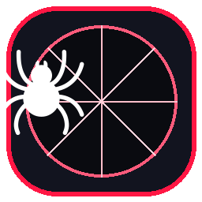
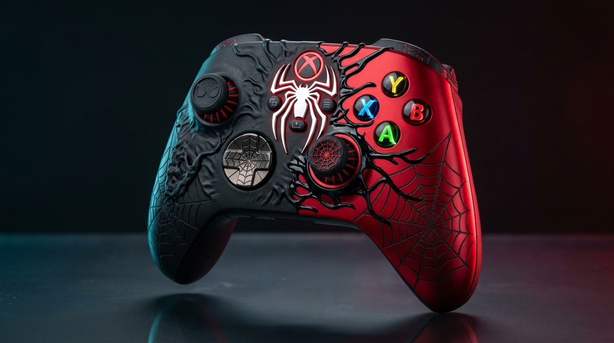
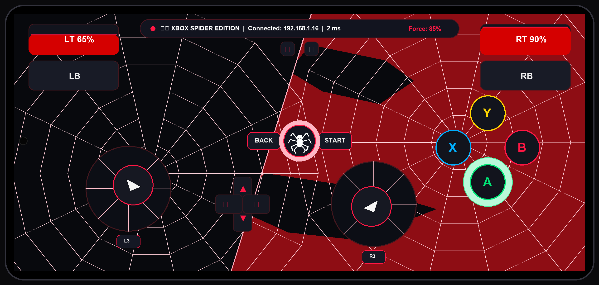

<div align="center">
  
  <h1>ArachnidPad 🕷️ — WiFi Gamepad (Crimson Arachnid Edition)</h1>
  <p><b>Ultra-Low Latency Android Wi-Fi Game Controller with ViGEmBus Controller Emulation, Force Feedback Rumble, Gyro Motion & 4-Player Local Co-Op</b><br/><i>UI Design & Art Direction by <a href="https://github.com/vitalityuser">@vitalityuser</a></i></p>

  <p>
    <a href="https://github.com/VitalityUser/wifi-gamepad/releases"></a>
    
    
    
    
  </p>
</div>

> **ArachnidPad (WiFi Gamepad: Crimson Arachnid Edition)** turns any Android device into a high-performance, ultra-responsive wireless PC game controller over local Wi-Fi. Featuring custom 20-byte packed binary UDP transmission streaming at 60–120 Hz, sub-2ms network response, native dual-motor Force Feedback (Rumble) streamed from PC games directly to phone haptics, Gyroscopic Steering and FPS Micro-Aiming, 18 Hz Rapid-Fire Turbo, Virtual Touchpad Mouse mode, and 4-Player local co-op.

---

## 📱 Visual Showcase & Hardware Concepts

<div align="center">
  <table>
    <tr>
      <td align="center" width="50%">
        <b>🕷️ Crimson Arachnid Edition Hardware Concept</b><br/><br/>
        
      </td>
      <td align="center" width="50%">
        <b>🎮 ArachnidPad Real-Time Touch Controller UI</b><br/><br/>
        
      </td>
    </tr>
  </table>
</div>

---

## 🔍 Feature Comparison

| Feature | Generic Virtual Gamepads | ArachnidPad (WiFi Gamepad) |
| :--- | :--- | :--- |
| **PC Game Compatibility** | ⚠️ Requires manual joypad mapping | 🎮 **100% Native (Emulates Genuine Controller via ViGEmBus)** |
| **Transmission Protocol** | ❌ High-latency TCP / HTTP (>30ms) | ⚡ **Custom 20-Byte Binary UDP (<2ms latency, 60–120 Hz)** |
| **Game Force Feedback** | ❌ None | 📳 **Bidirectional PC Game Rumble streamed to phone motors** |
| **Motion Controls** | ❌ None | 🏎️ **Dual Gyro: Tilt-to-Steer & FPS Micro-Aiming** |
| **Rapid Fire** | ❌ Manual tapping only | ⚡ **Hardware-timed 18 Hz Rapid-Fire Turbo Mode** |
| **Desktop Navigation** | ❌ Separate mouse app needed | 🖱️ **Integrated Touchpad Mouse mode with Tap-to-Click** |
| **Multi-Player Support** | ❌ Single player only | 👥 **Up to 4 Phones connected simultaneously (P1–P4 Co-Op)** |
| **Connection Setup** | ⚠️ Manual IP entry required | 📡 **UDP Auto-Discovery Beacon (Instant 1-Tap Connect)** |
| **Aesthetics & Themes** | ⚠️ Outdated generic UI | 🕷️ **4 Built-in Themes (Crimson, Ice, Velocity, Cyberpunk)** |

---

## 🚀 Key Features

### 1. 🕷️ 4 Distinct Visual Themes
- **Crimson Arachnid**: Deep basalt dark carbon body with glowing crimson geometry and jewel action buttons.
- **DualSense Ice**: Glacier white layout accented with cyber-cyan backlighting.
- **Velocity Green**: Matte dark carbon with electric lime green highlights.
- **Cyberpunk Neon**: High-voltage yellow and magenta futuristic layout.

### 2. 📳 Bidirectional Force Feedback (True Game Rumble)
- When a game triggers vibration motors on PC, the server captures the DirectX XInput vibration signals via ViGEmBus and streams the heavy and light motor intensities back to your phone over UDP in real time.
- Fully supports phone linear haptic actuators and tactile feedback on button presses.

### 3. 🏎️ Gyroscopic Steering & 🎯 FPS Micro-Aiming
- **Racing Steering Mode**: Tilt your smartphone like a steering wheel to steer smoothly in driving games (mapped to Left Thumbstick X).
- **FPS Micro-Aiming Mode**: Tilt your device for fine crosshair aiming and precision adjustments (mapped directly to Right Thumbstick X/Y).
- Easily toggle between **OFF**, **RACING_STEER**, and **FPS_AIM** directly from the top status bar.

### 4. ⚡ 18 Hz Rapid-Fire Turbo Mode
- Tap the **⚡ Turbo** button to activate hardware-timed 18 Hz cycling for action buttons. Hold any button to output continuous high-frequency inputs.

### 5. 🖱️ Integrated Touchpad Mouse & Desktop Control
- Switch to **Touchpad Mouse Mode** with a single tap. Drag on screen to control the Windows cursor, with tap-to-click functionality for hassle-free menu navigation.

### 6. 👥 4-Player Local Co-Op
- Connect up to 4 Android devices simultaneously on the same local network. The PC server automatically provisions Player 1 through Player 4 virtual controller slots.

### 7. 📡 UDP Auto-Discovery Beacon
- The companion server broadcasts an automatic beacon on UDP 8889, allowing the Android app to discover and connect to your PC without typing manual IP addresses.

---

## 🎮 Controller Layout

```
 ____________________________________________________________________
| [LT]  [LB]      [GYRO: OFF/STEER/AIM]  [TURBO]  [MOUSE]     [RB]  [RT] |
|                                                                    |
|     ( ^ )           [BACK]     ( 🕷️ )     [START]            ( Y )   |
|   < DPAD >                      GUIDE                     ( X ) ( B )|
|     ( v )                                                    ( A )   |
|                                                                    |
|           (( LS / L3 ))                         (( RS / R3 ))      |
|____________________________________________________________________|
```

---

## ⚡ Quick Start & Installation

### Step 1: Run the PC Companion Server (Windows)
1. Clone or download the repository:
   ```powershell
   git clone https://github.com/VitalityUser/wifi-gamepad.git
   cd wifi-gamepad/pc-server
   ```
2. Start the server (Requires Python 3.8+ on Windows):
   ```powershell
   python server.py
   ```
3. *Optional for Virtual Controller Emulation*: If ViGEmBus is not yet installed on your system, click the **"📥 1-Click Install ViGEm Driver"** button inside the server dashboard. *(Otherwise, the server runs in Keyboard & Mouse fallback mode).*

### Step 2: Install the Android App
- Download the pre-built APK from the [`bin/`](bin/WiFiGamepad.apk) directory:
  - **[`WiFiGamepad.apk`](bin/WiFiGamepad.apk)**
- Open the APK on your device (Android 8.0 or newer) and grant vibration permissions.

### Step 3: Connect & Play
1. Ensure your phone and PC are connected to the same Wi-Fi network (or PC Mobile Hotspot).
2. Open the app on your phone — it will detect the PC server and connect automatically.
3. Start any PC game and play with wireless control!

---

## 🛠️ Building from Source

### Android APK (Gradle)
```powershell
cd android
./gradlew assembleDebug
```
The compiled output APK will be located at:
`android/app/build/outputs/apk/debug/app-debug.apk`

---

## 🔬 Network Protocol Specification

Ultra-compact 20-byte packed binary packet structure over UDP:

```c
struct __attribute__((__packed__)) GamepadPacket {
    char     magic[2];       // "GP" (0x47, 0x50)
    uint16_t seqNumber;      // Monotonically increasing sequence ID
    uint16_t buttons;        // 16-bit bitmask (A, B, X, Y, LB, RB, etc.)
    uint8_t  leftTrigger;    // 0 to 255
    uint8_t  rightTrigger;   // 0 to 255
    int16_t  leftStickX;     // -32768 to 32767
    int16_t  leftStickY;     // -32768 to 32767
    int16_t  rightStickX;    // -32768 to 32767
    int16_t  rightStickY;    // -32768 to 32767
    int16_t  gyroX_deltaX;   // Gyro yaw / Trackpad mouse delta X
    int16_t  gyroY_deltaY;   // Gyro pitch / Trackpad mouse delta Y
};
```

---

## 👤 Author & Design
- **Developer & Maintainer**: [@vitalityuser](https://github.com/vitalityuser)
- **UI Design & Art Direction**: [@vitality_user](https://github.com/vitalityuser)
- **License**: MIT Open Source
